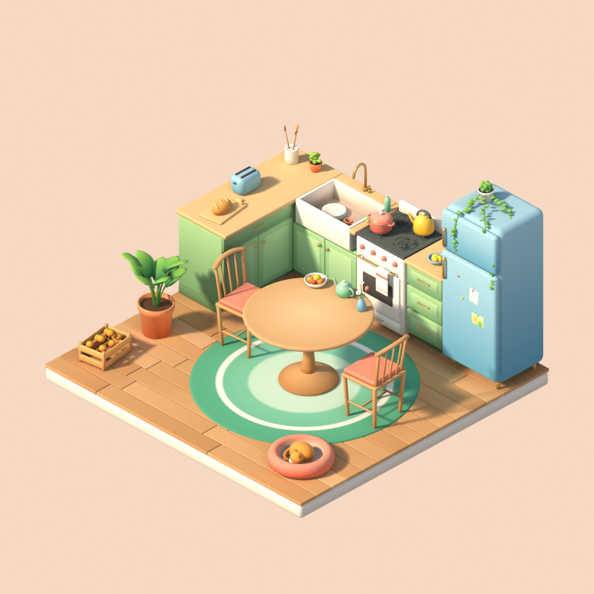

# 场景说明:厨房

版本:v0.2 · 2026-10-14 · 状态:**v0.2 改成更鲜明、不奶油的配色**;墙还没加
用途：新开会话或换人接手时，先读这一页，不用翻聊天记录。



## 1. 一句话
一个**小而温馨、清新、色彩鲜明**的等距厨房：鲜绿橱柜、蜂蜜色木台面和地板、天蓝色复古冰箱、白色灶台和水槽，中间一张小圆桌。风格是 **soft low-poly,但比低多边形细一点**:所有硬边都倒圆角、平滑着色，颜色是柔和的上浅下深渐变。之后**进 VR**,患者坐在圆桌前。

## 2. 参考，各管一件事
参考都在 `~/Documents/HEXR-Meta/Art ref/`,**只参考，模型全部自建**。
| 管什么 | 参考 | 用法 |
|---|---|---|
| 构图 | `model ref 1.png`(等距 L 形厨房) | L 形橱柜靠两面墙，冰箱，中间是用餐区，木地板 |
| 颜色、柔和度 | `model+color style .png`(暖桃色卧室) | 圆润倒角，暖光柔影，奶油色配蜂蜜木，地板带厚底座 |
| 道具 | `model+style ref .mp4`(灶台小景) | 灶台加烤箱、锅、砧板和面包、烤面包机、调料架、窗和绿窗帘 |
| 道具密度 | `model ref2/`、`model ref 3/` 两个 FBX | 只看布局。ref 3 有 67.7 万三角面，不能导入 |

## 3. 已定
- 用途：等距展示，**也进 VR 坐着用**。
- 中间放**小圆桌(Ø1.2 m)加 2 把椅子**。椅子在桌子左右两侧，患者坐在前方开口处，面朝 +Y 看灶台。
- 配色：**鼠尾草绿橱柜加蜂蜜木**(见第 5 节)。
- v0.2(同日):**整体更鲜明，不要太奶油**。所有点缀色提高饱和度；奶油色一律改成干净的白；冰箱换成天蓝色；木色往自然蜂蜜色收，避免发橙。奶油版的等距图留作对比:`preview/kitchen/kitchen_iso_v1_cream.png`。
- **挂墙的东西现在就做好**，放在隐藏集合 `Kitchen_WallMounted`,加了墙再打开对位。
- 资源：Blender MCP 插件里的 **Sketchfab 没开**，所以这版**全部自建**,`ASSET_CREDITS.md` 不用加东西。以后要用 Sketchfab 的模型，只收 CC0 / CC-BY,导入后要重新上色、平滑。

## 4. 尺寸与坐标(米,Z 向上)
| 项 | 值 |
|---|---|
| 地台 | x −1.90 … 1.40,y −1.50 … 1.70(3.3 × 3.2 m);木地板顶面 z = 0,奶油色底座厚 15 cm |
| 以后的墙 | **后墙平面 y = 1.70,左墙平面 x = −1.90**;天花板按 2.60 m 设 |
| 圆桌 | 圆心在**世界原点**,桌面 z = 0.74,直径 1.2 m,单柱圆底座(不挡腿) |
| 坐姿视线 | 眼睛在 (0, −0.90, 1.15),朝 +Y(空物体 `Player_Eye_Ref`) |
| 操作区 | 桌面正中 **0.9 × 0.5 m 保持空**(线框 `Marker_OperationZone`,不渲染);茶壶、果盘、花瓶只放在后半圈 |
| 台面 | 高 0.90 m,深 0.635 m;后排：水槽柜 + 灶台 + 三抽柜 + 冰箱;左排：双门柜 + 转角 |
| 椅子 | 没有放在患者的位置上，患者坐真实椅子(书房的做法) |

## 5. 配色(v0.2,sRGB,每对是「底部 → 顶部」的渐变)
| 用途 | 色 |
|---|---|
| 橱柜(鲜绿) | `#6FA375` → `#A4D39A`;门板凸面 `#80B183` → `#B4DDA9`;踢脚 `#527D56` |
| 台面(蜂蜜木) | `#D3A46D` → `#F0CC96` |
| 地板 | `#DCAC79` 等 5 种木色随机，靠墙一侧稍暗；底座是浅中性色 `#D8D3CC` → `#F7F5F1` |
| 桌面 / 桌腿、椅子 | 中心 `#EED0A2`,边缘 `#D0A170` / `#BC8752` → `#DDAE78` |
| 冰箱 | 天蓝 `#5FA7CC` → `#A3D5EE` |
| 灶台、水槽、罐子、盘子 | 干净的白 `#DAD8D3` → `#FFFFFF`(**不用奶油色**);五金是黄铜色 `#B5843A` → `#EDC97B` |
| 地毯 | 薄荷绿 `#5CB794`、浅薄荷 `#7FCDAF`、白色条纹 `#FAFAF7` |
| 点缀 | 珊瑚 `#E0604C` → `#F89C85`(锅、坐垫、旋钮、猫窝)、黄油黄 `#F1B42A` → `#FFDA5E`(水壶、吊灯罩)、天蓝 `#5BA8D0` → `#9DD3EE`(烤面包机、花瓶)、薄荷 `#58B996` → `#A0E1C3`(茶壶) |
| 植物 | `#2C7E4B` → `#92D05C`;陶盆 `#C95E37` → `#EE9764` |

## 6. 光(只用于 Blender 预览)
- 一盏暖色太阳光 `#FFE5C2`(v0.2 收掉了偏橙的色偏),强度 4.8,角度 6°,**从开口的前方偏左照进来**:影子往后墙方向投，从等距镜头和座位都看得到。之前从右前方照，影子全落在物体背后，看不出来。
- 天光：底部 `#F3E7DC`、顶部淡蓝 `#BFD9F2`,强度 0.55,让阴影偏冷一点、显得清新。镜头背景单独设成浅桃色 `#F6D8C3`,不参与照明。
- 色彩管理:**Standard**(不做色调压缩)。这样预览图里的颜色就接近顶点色在 Unity 里的样子;之前用的 Filmic 会把颜色压灰、显得奶油。EEVEE 打开光线追踪和快速 GI。
- 进 Unity 后照书房的做法**烘焙**，不用实时阴影。

## 7. 文件
| 文件 | 内容 |
|---|---|
| `art/blender/kitchen.blend` | 当前场景;相机 `Cam_Iso`(正交等距)、`Cam_Seat`(坐姿)、`Cam_Overview` |
| `art/scripts/build_kitchen_diorama.py` | 生成整个场景(可在无界面模式下跑，也可在打开的 Blender 里跑) |
| `docs/art/preview/kitchen/` | 预览图:`kitchen_iso.png`、`kitchen_seat.png`、`kitchen_overview.png`;`kitchen_iso_v1_cream.png` 是奶油版，留作对比 |

重新生成(会**覆盖** `kitchen.blend`):
```bash
/Applications/Blender.app/Contents/MacOS/Blender -b --factory-startup --python art/scripts/build_kitchen_diorama.py
```
**注意**:脚本会清空场景再重建。一旦在 Blender 里**手动改过**,就别再整份重跑，改动会丢。

## 8. 结构与做法
- 集合:`Kitchen_Floor`(地台、地毯)、`Kitchen_Counters`(橱柜、台面、水槽、灶台、冰箱)、`Kitchen_Table`(桌、椅、桌上摆件)、`Kitchen_Props`(台面小物、锅和水壶、两盆植物、橙子箱、猫窝)、`Kitchen_WallMounted`(**隐藏**:窗和窗帘、油烟机、左墙开放搁板、调料架、挂钟、吊灯)、`Kitchen_Markers`、`Lighting`、`Cameras`。
- 6 个共用材质 `K_Matte / K_Satin / K_Metal / K_Glass / K_Leaf / K_Glow`,颜色都来自顶点色属性 `Col`(float)。和花园一样，**导出 Unity 前要么烘成调色板贴图，要么用读顶点色的 Shader**。
- 每个硬物体都有 `SoftNormals`(Weighted Normal)修改器，导出时要应用。
- 水槽柜的柜体只做到 0.64 m 高，让开上面的水槽(之前柜体顶面把水槽填平了)。

## 9. Quest 预算
- 可见约 **6.5 万三角面**(含隐藏集合共 8.5 万)，在 15–20 万的目标内。
- 面数最多的：台面小物 1.1 万、冰箱上的绿萝 0.78 万(叶子多，最好减)、灶台 0.69 万、地板 0.6 万。
- 小而碎的东西(水果、叶子、调料瓶)用光照探针，不要分光照贴图(书柜的教训)。

## 10. 待定
1. 桌子 Ø1.2 m 是为了放下 0.9 × 0.5 m 的操作区，在画面里偏大。能不能缩小操作区，或者把桌子改成椭圆?
2. 窗在后墙上：加墙时要开洞，还是保留现在这种不透明的「假窗」(玻璃是淡蓝色自发光)?
3. 患者身后(前方开口处)目前空着。VR 里转身会看到空的，要不要补墙或者放远景?
4. T5「吃饭」任务的碗、勺放在哪里，等任务方案定了再摆。
5. Sketchfab 打开以后，要不要换几个道具(如绿植、烤面包机)?
