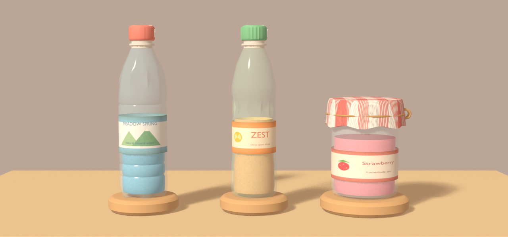
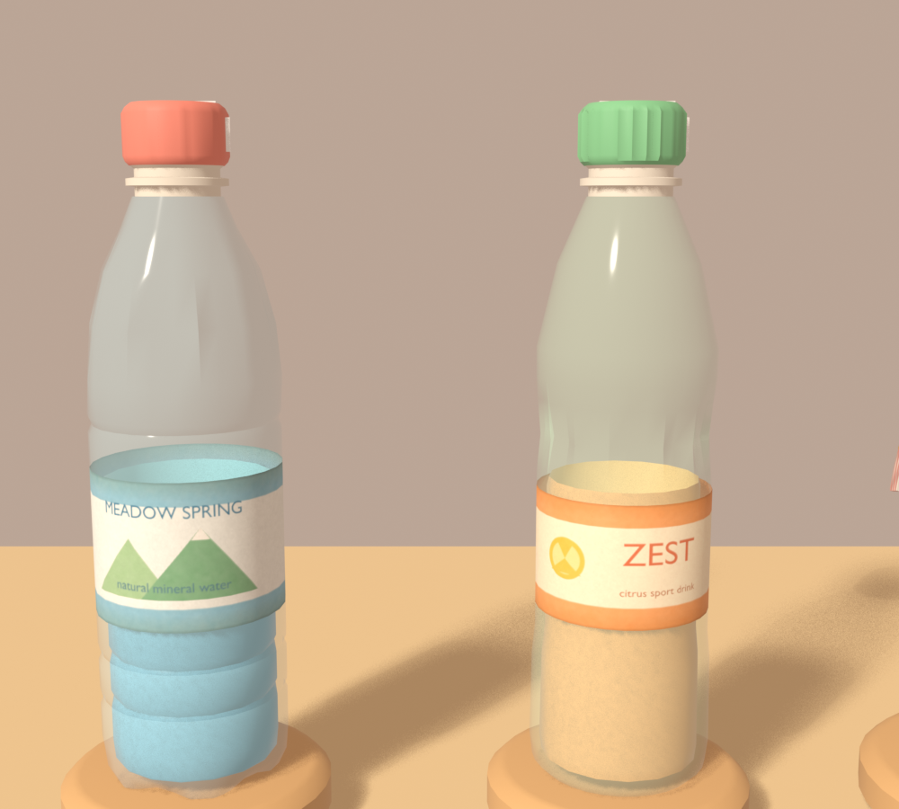
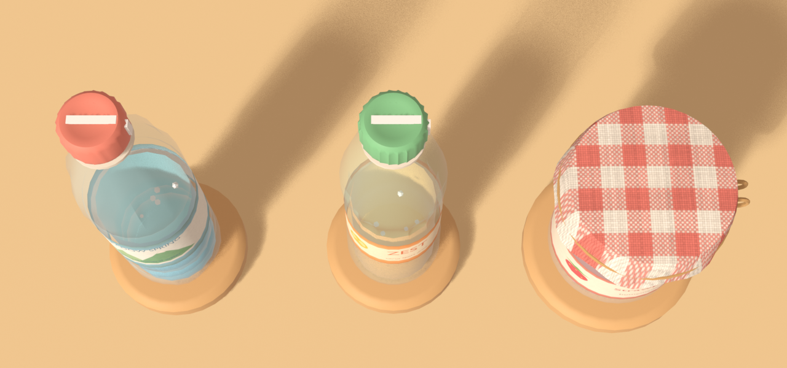

# T11 拧瓶盖:模型交付说明(给 Unity 会话)

版本:v0.3 · 2026-10-18(细节版:更像真实容器但保持柔和风格;英文标签;罐子格子布罩) · 状态:**Blender 模型完成并已导出**,Unity 里还没换

> v0.3 改动:**每组面数上限从 2k 提到 3.5k**(已与项目负责人确认);新增 `<Group>_Bubbles`;罐子盖子外面加了布罩和麻绳,**罐子的 capRadius 建议改为 0.052**(见第 3 节)。
规格来源:T11 模型说明(交接页);任务逻辑见 `docs/11-learning-t1-t2.md` 的 T11 一节。





## 1. 文件
| 文件 | 内容 |
|---|---|
| `art/blender/HexR_T11_Bottles.blend` | 三个集合 `Bottle_Tight` / `Bottle_Loose` / `Jar`(预览用的桌子、相机、灯在 `Preview_Only`,不导出) |
| `Assets/Art/Props/T11/Bottle_Tight.fbx`、`Bottle_Loose.fbx`、`Jar.fbx` | 每组一个 FBX |
| `art/textures/t11/Palette_Base.png` | 不透明部件的调色板图集,FBX 内嵌 |
| `art/textures/t11/label_tight.png`、`label_loose.png`、`label_jar.png` | 英文插画标签(1024×256,自己用图形和文字渲染,无第三方素材) |
| `art/textures/t11/gingham_jar.png`(导出时缩成 `gingham_jar_s.png`) | 罐子布罩的格子纹(程序生成) |
| `art/scripts/build_t11_bottles.py` | 生成 `.blend`(无界面可跑) |
| `art/scripts/export_t11.py` | 导出 FBX(无界面,不碰打开的 Blender) |

重做:`Blender -b --factory-startup --python art/scripts/build_t11_bottles.py`,再 `Blender -b art/blender/HexR_T11_Bottles.blend --python art/scripts/export_t11.py`。

## 2. 层级与命名(每个 FBX)
```
<Group>                根空物体,原点 = 底座底面中心,Y 向上(Blender +Z)
  <Group>_Base         底座(木色杯托,比瓶身宽 3 cm、高 2 cm)
  <Group>_Body         瓶身/罐身:半透明一层 + 英文插画标签(UV:绕一圈 = u 0→1,正面朝患者在 u = 0.75)
  <Group>_Liquid       液体:整个瓶内腔的封闭网格(瓶身 + 瓶颈内),液面高度由着色器切(见第 6 节)
  <Group>_Bubbles      几颗小气泡,在默认液面以下(改液面时可能露出,可隐藏;罐子是空物体)
  <Group>_Neck         瓶颈:螺纹 + 支撑环(仅两个瓶子;不做防盗环)
  <Group>_Cap          瓶盖(单独物体)
```
**瓶盖**:原点在**瓶子中轴线上、盖子中心**(局部位置 `(0, 0.24, 0)` 瓶 / `(0, 0.14, 0)` 罐,单位米),绕自身"向上"轴转即可。瓶盖顶有一条**白色横条**、侧面一条白色竖条;罐子靠**布罩格子和右侧(+X)的麻绳蝴蝶结**看出转动。罐子的布罩、麻绳都在 `Jar_Cap` 里,随盖子一起转。

## 3. 尺寸(米,实测自导出文件)
| 组 | 总高 | 瓶身 | 瓶盖 | `capRadius` 建议 |
|---|---|---|---|---|
| `Bottle_Tight` | 0.251 | Ø0.065 × 0.20(花瓣底、握持环纹) | Ø0.034 × 0.02,中心高 0.24 | **0.017** |
| `Bottle_Loose` | 0.251 | Ø0.063 × 0.20(腰身竖纹) | Ø0.034 × 0.02,中心高 0.24 | **0.017** |
| `Jar` | 0.154 | Ø0.09 × 0.11 | 金属盖 Ø0.094 × 0.02,中心高 0.14;外罩布到半径约 0.054,蝴蝶结伸到约 0.061 | **0.052**(按布罩外沿;原来 0.047 是金属盖) |
底座直径:瓶 0.095、罐 0.12,高 0.02。**瓶盖半径和规格一致,没有改**。三角面:3472 / 3232 / 3240(都 ≤ 3.5k)。

## 4. 区分三种容器(外观不暗示松紧)
| 组 | 瓶型 | 盖色 | 液体色 |
|---|---|---|---|
| `Bottle_Tight` | 矿泉水瓶 "MEADOW SPRING" | 珊瑚 `#EE8D7C`,28 道细滚花 | 浅蓝 |
| `Bottle_Loose` | 运动饮料瓶 "ZEST" | 鼠尾草绿 `#86C894`,22 道滚花 | 蜜桃橙 |
| `Jar` | 果酱罐 "Strawberry homemade jam",格子布罩 + 麻绳 | 黄油黄金属盖(大部分被布罩盖住) | 莓果粉红 |
颜色柔和,和之前"紧=红、松=绿、罐头=黄"的白模对应,换了的只是形状和质感。

## 5. Unity 里要做的
1. 导入 FBX 后,材质页点 **Extract Textures / Materials**;`Palette_Base.png` 设 **Point 过滤、不生成 Mipmap**(和书房一样)。
2. 瓶盖等用 `M_Palette`(URP/Lit,Smoothness 调低);罐盖的布罩是 `M_T11_Gingham`(带贴图)。
3. **`T11_Glass_*` 是半透明材质,FBX 不会带透明模式**:要手动改成 **URP/Lit,Surface Type = Transparent**,Alpha 约 0.34,单层不叠;嫌 Quest 开销大可改不透明(把 Alpha 改 1,液体就看不见)。`T11_Label_*` 是不透明的标签贴图,建议 Bilinear、开 Mipmap。
4. 把模型换进 `Learning_T11` 下的 `Container_0/1/2`,重新指定 **cap**(`<Group>_Cap`)和 **capRadius**。
5. 液体换成液体着色器并加晃动脚本(见第 6 节)。
6. 盖子拧开后会落在**组原点右侧约 9 cm、靠近患者约 4 cm**的桌面上,这里什么都没放。

## 6. 液体(方案 B:晃动液体着色器,Unity 会话来写)
**为什么这样做**:要看起来是液体、瓶子动时液面会晃,但 Quest 跑不起流体模拟。做法是 VR/手游常见的"切开 + 背面当液面"。

**网格(Blender 已做好)**
- `<Group>_Liquid` 是**整个内腔**的封闭网格,比瓶身内缩 3.5 mm,原点和组原点重合(底座底面中心)。
- 高度范围:瓶 0.026–0.236 m(含瓶颈内),罐 0.026–0.126 m。
- 默认液面高度(Blender 自定义属性 `fill_height_m`,单位米,从底座底面算):`Bottle_Tight` **0.125**、`Bottle_Loose` **0.125**、`Jar` **0.100**(两个瓶子同高,避免液面高低暗示松紧;罐子提到 0.10,让果酱从标签上方露出来)。
- 矿泉水瓶的液体跟着瓶身的握持环纹有起伏,这是刻意的。
- 液体材质 `T11_Liquid_<Group>` 只是占位,导入后换成液体着色器。颜色:浅蓝 `#86CBEA`、蜜桃橙 `#F6BC76`、莓果粉 `#E36F7D`;液面色 = 同色提亮约 35%。

**着色器需求(URP,Shader Graph 或手写都行)**
| 项 | 要求 |
|---|---|
| 参数 | `_LiquidColor`、`_TopColor`、`_FillHeight`(米)、`_WobbleX`、`_WobbleZ` |
| 切开 | 片元在 **世界空间**里相对物体原点的高度 `y` 大于 `_FillHeight + _WobbleX·x + _WobbleZ·z` 就丢弃(`clip`)。用世界空间,瓶子倾斜时液面也保持水平 |
| 液面 | 关闭背面剔除(Cull Off);**背面**(看到内壁)画成 `_TopColor`,法线当作朝上,光照平一点 |
| 渲染 | **不透明 + Alpha Clip**,队列在玻璃之前;瓶身玻璃仍是单层透明 |
| 性能 | 每个容器一个材质实例或 MaterialPropertyBlock;无额外 pass |

**晃动脚本(一个小 MonoBehaviour)**
- 读容器的移动速度(和角速度,如果以后会转动),换成目标倾斜量,用**带阻尼的弹簧**衰减:晃两三下、一两秒内平静,频率约 2–3 Hz,幅度设上限,别晃出瓶口。
- 每帧把结果写进 `_WobbleX/_WobbleZ`。
- 辅助时瓶子平移、拧盖时手的扰动,都会让液面晃一下。

**Blender 里的预览**:`.blend` 里的液体材质已经按同样原理做了预览(液面以上透明、背面浅色),在 Blender 里能看到切开后的液面效果;它不会随 FBX 导出。

## 7. 没做的 / 注意
- 全部自建(标签图案和文字是自己渲染的,格子纹是程序生成的),**没有第三方资源**,`ASSET_CREDITS.md` 不用加。
- 导出和 Unity 里的实际效果、透明排序、`capRadius` 触碰手感**还没在 Unity 里验证**。
- 预览图里的颗粒是 EEVEE 预览噪点,不是模型问题。
